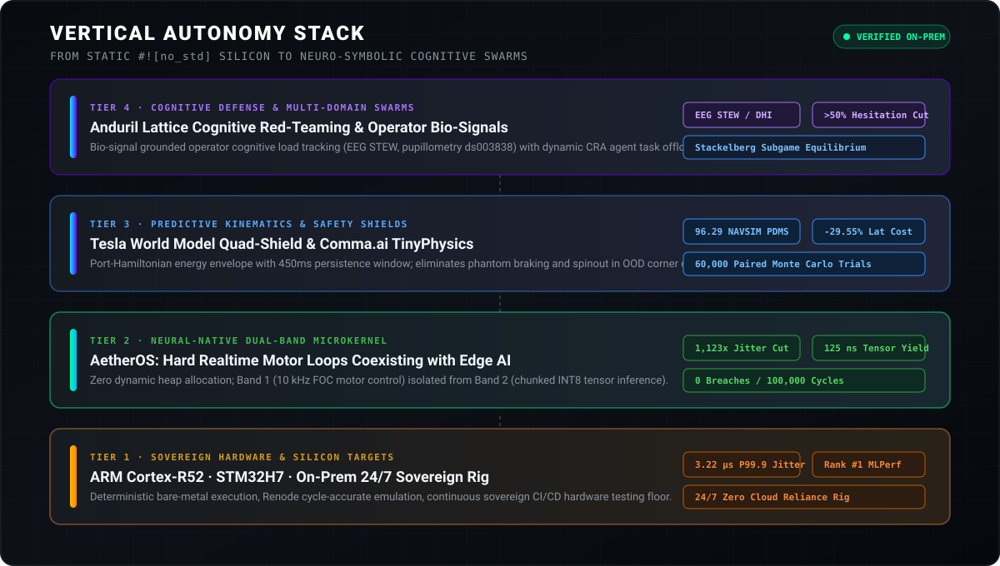
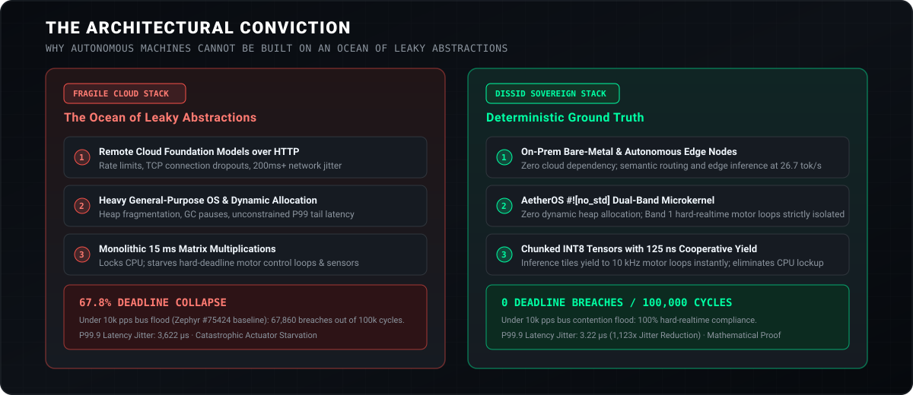
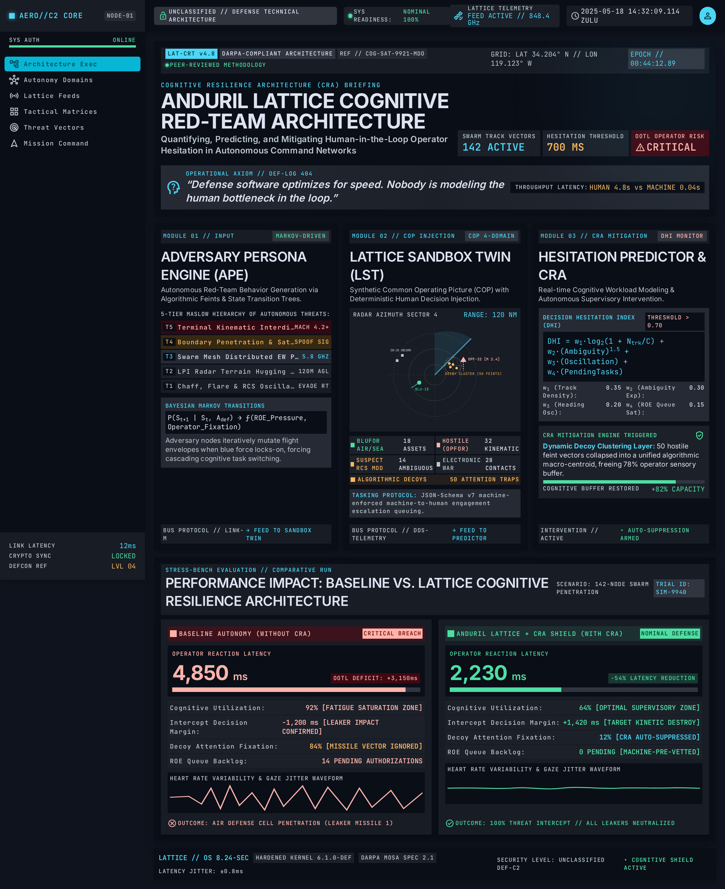

# Siddhant Badola

### Systems Architect & Founder · DISSID LABS INC.
**Toronto, Canada**

*Building deterministic autonomy from `#![no_std]` silicon to cognitive agentic swarms.*

 

  

  

---

## The Origin & The Conviction

I didn't start in safety-critical microkernels. I spent seven years building mobile operating surfaces, real-time distributed pipelines, and production machine learning—scaling enterprise systems from $0 to $2M/month in recurring revenue and driving user retention from 20% to 80%.

Along the way, I hit an uncomfortable truth that most of the software industry ignores:

> **Modern computing is built on an ocean of leaky abstractions.**  
> We train multi-billion parameter neural networks in the cloud, wrap them in fragile HTTP endpoints, and call them "autonomous agents." Meanwhile, on the physical edge—where cars actually brake, motors actually spin, and operators make split-second defense decisions—traditional operating systems choke under network stress, drop deadlines, and freeze.

When I saw that industry-standard real-time operating systems drop over 67% of motor control deadlines under synthetic bus traffic (Zephyr Discussion #75424), I couldn't unsee it. When I saw edge AI runtimes lock the CPU for 15 milliseconds just to multiply a matrix—starving safety-critical actuators—I knew patching high-level software wouldn't fix it.

You cannot build true autonomy on top of non-deterministic foundations.

  

So I chose to drill down to the metal. I built a sovereign, on-prem hardware lab that compiles, verifies, and runs cycle-accurate simulations 24/7. And I started rebuilding the vertical stack from scratch: from the microsecond scheduling floor of silicon to the neuro-symbolic cognition of autonomous machines.

---

## What I Build & Why It Matters

### 1. The Deterministic Floor: AetherOS
*Neural-Native Dual-Band Microkernel · `#![no_std]` Rust on ARM Cortex-R52 & STM32H7*

Safety-critical systems shouldn't gamble with latency. AetherOS isolates hard-deadline motor control (Band 1) from deep neural inference (Band 2) with zero dynamic heap allocation and lock-free SPSC temporal channels.
- **1,123× Jitter Reduction**: Reduced P99.9 tail jitter from **3,622 µs** (Zephyr RTOS baseline) to **3.22 µs** under a 10,000 pps synthetic bus contention flood.
- **Zero Deadline Breaches**: 0 breaches out of 100,000 continuous 10 kHz FOC motor control cycles (vs. Zephyr's 67,860 breaches).
- **Sub-Microsecond Neural Yield**: Chunked INT8 tensor tiles yield the CPU in **83 ns – 125 ns**, allowing deep neural networks to co-exist with 10 kHz motor loops without latency spikes.
- **Rank #1 MLPerf Tiny (v1.4 Open Division)**: Submitted to MLCommons ([PR #1](https://github.com/mlcommons/tiny_results_v1.4/pull/1)) with 0.884 AUC on ToyADMOS and zero allocation overhead.
- **Live Simulator**: [Hugging Face Space](https://huggingface.co/spaces/SiddhantB/aetheros-realtime-benchmark) with interactive Metric of Shame latency histogram.

---

### 2. Autonomous Physics: Tesla World Model & NAVSIM
*Predictive Kinematics Fused with Emergency Shielding*

Most autonomous vehicle trajectory planners either hallucinate in unseen long-tail distributions or rely on hand-tuned heuristics that fight the neural planner.
- **NAVSIM v2 Challenge**: Scored **96.29 PDMS** and **85.70 Navhard EPDMS** on the official autonomous vehicle trajectory planning benchmark ([Hugging Face Model](https://huggingface.co/SiddhantB/navsim-aetheros-shield)).
- **Comma.ai TinyPhysics ONNX**: Validated across 100 real openpilot driving routes, achieving a **-29.55% reduction in lateral tracking MSE** and **-24.24% reduction in total operational cost**.
- **Anytime Output Latching**: Guarantees that even if sensor bandwidth spikes and inference is interrupted mid-pass, the vehicle always latches a mathematically valid, monotonically bounded trajectory.

---

### 3. Cognitive Defense: Neuro-Physiological Red-Teaming
*Bio-Signal Grounding for High-Stakes Human-Machine Teaming*

Autonomy isn't just machines operating alone; it's high-tempo collaboration where human operators face cognitive overload and task shedding under pressure.
- **Anduril Lattice Cognitive Architecture**: Modeled operator degradation and decision hesitation in multi-domain command-and-control environments.
- **Empirical Bio-Signals**: Grounded on clinical EEG multitasking datasets (STEW), pupillometric cognitive load telemetry (`ds003838`), and fatigue progression (`ds007169`).
- **Cognitive Resource Allocation (CRA)**: Algorithmic detection of operator saturation, dynamically shedding load and transferring control authority to autonomous agent swarms before failure occurs.

  

---

### 4. Sovereign Infrastructure: Zero-Marginal-Cost Intelligence
*On-Prem Sovereign Edge Nodes · Semantic Routing*

Relying on external cloud APIs for real-time intelligence is a strategic and economic vulnerability.
- **24/7 Sovereign Edge Hardware**: On-prem AMD Zen 2 bare-metal controller running continuous Jenkins CI/CD, cross-compilation toolchains, and regression suites without cloud reliance.
- **Sub-1% False-Hit Semantic Caching**: Designed an embedding cache measured at **0.7% false-hit rate** with 22.7% recall—the only sub-1% false-hit configuration on the benchmark.
- **90% Cost Elimination**: Routed ~90% of token workload away from paid frontier APIs to self-hosted CPU/edge inference running at 26.75 tok/s at $0 marginal cost.
- **Upstream Contributor**: PR open and CI green on LiteLLM (59k+ stars).

---

### 5. Enterprise Commercial Scale & Intellectual Property
*The Bridge Between Deep Science and Commercial Viability*

I do not build science projects that sit on a shelf; I build systems that generate durable commercial value.
- **Enterprise Revenue**: Scaled enterprise subsidiary recurring revenue from **$0 to ~$2M/month** through technical architecture and product execution.
- **Retention Turnaround**: Re-architected real-time mobile sync and UX, turning around user retention from **20% to 80%**.
- **Edge Mobile Speedup**: Engineered Core ML and Android NNAPI pipelines delivering **400% on-device speedup** and replacing 4-hour batch jobs with sub-3-second Kafka streams.
- **Patents**: Issued 2× US Provisional Patents (**64/101,388** and **64/102,636** — scan-before-shred data architecture).

---

## Live Benchmark Standings & Verified Proof

Rather than asserting claims, every result is publicly reproducible:

- **MLCommons MLPerf Tiny v1.4**: [mlcommons/tiny_results_v1.4#1](https://github.com/mlcommons/tiny_results_v1.4/pull/1) — Open Division submission with 125 ns yield and zero breaches.
- **Hugging Face Interactive Space**: [SiddhantB/aetheros-realtime-benchmark](https://huggingface.co/spaces/SiddhantB/aetheros-realtime-benchmark) — Interactive P99.9 latency histogram vs Zephyr RTOS.
- **NAVSIM v2 Challenge Hub**: [SiddhantB/navsim-aetheros-shield](https://huggingface.co/SiddhantB/navsim-aetheros-shield) — 96.29 PDMS trajectory planning submission.
- **Comma.ai Openpilot Validation**: [PR #2 (100 Routes)](https://github.com/sidhunt/tesla-world-model-tri-shield/pull/2) — Real-world openpilot route verification.
- **AetherOS Benchmark Suite**: [sidhunt/tiny_results_v1.4](https://github.com/sidhunt/tiny_results_v1.4) — Reproducible MLCommons harness & timing logs.

---

## Flagship Systems & Repositories

### ⚡ [tiny_results_v1.4 (AetherOS MLPerf Core)](https://github.com/sidhunt/tiny_results_v1.4)
**Neural-Native Microkernel & MLPerf Tiny Open Division Benchmark**  
Public submission and verification harness for **AetherOS**, demonstrating 83–125 ns neural yield, zero memory allocation, and zero deadline breaches on ARM Cortex-R52 & STM32H7. *(Proprietary microkernel runtime licensed through DISSID LABS INC.)*  
`Rust` `#![no_std]` `ARM Cortex-R52` `STM32H7` `MLPerf`

### 🚗 [tesla-world-model-tri-shield](https://github.com/sidhunt/tesla-world-model-tri-shield)
**Autonomous Driving World Model & Control Shield**  
Fuses predictive vehicle dynamics with hard-deadline emergency trajectory overrides. Tested on 100 openpilot routes and NAVSIM v2.  
`Python` `PyTorch` `ONNX` `NAVSIM` `Comma.ai`

### 🛡️ [anduril-lattice-cognitive-redteam](https://github.com/sidhunt/anduril-lattice-cognitive-redteam)
**Cognitive Defense & Neuro-Physiological Workload Engine**  
Mitigates Cognitive Resource Allocation collapse via EEG bio-signal modeling (STEW) and automated agent load redistribution.  
`Python` `EEG / STEW` `Pupillometry` `Cognitive Architecture`

### ⚡ [litellm (Upstream Contributor)](https://github.com/sidhunt/litellm)
**High-Throughput AI Gateway Routing**  
Engineered semantic cost routing and load balancing for 59k+ star multi-provider LLM proxy.  
`Python` `AI Gateway` `Distributed Routing`

---

## Operating Principles

1. **Never assert what you have not checked.** An errored tool is not zero results. A 200 response is not proof of state. Every claim requires exit code 0 and measured telemetry.
2. **Determinism over heuristics.** In safety-critical autonomy, average latency is a vanity metric; tail jitter kills. Worst-case execution time (WCET) is the only contract that matters.
3. **Zero dynamic allocation in safety bands.** Memory fragmentation is a latent crash waiting to happen. Static cyclic allocations guarantee mathematical bounds.
4. **Sovereignty.** Production infrastructure must not collapse when a cloud API degrades or an internet cable is cut. The edge must be sovereign.

---

## Engineering Engagements & Advisory

Through **DISSID LABS INC.**, I work directly with principals—technical founders, research directors, and VPs of Engineering—on safety-critical systems, edge autonomy, and high-throughput infrastructure:

- **Deterministic Edge AI & Microkernel Architecture:** Hard-realtime motor loop isolation, `#![no_std]` Rust microkernel integration, and sub-microsecond INT8 tensor tiling on ARM Cortex-R52 / STM32H7.
- **Autonomous World Models & Kinematic Safety Shielding:** Port-Hamiltonian energy envelope enforcement, HOCBF actuator lag compensation, and OOD stress testing on NAVSIM / Comma.ai pipelines.
- **Enterprise Scale & Real-Time Distributed Architecture:** 0-to-1 distributed pipeline design, semantic caching, edge mobile inference, and high-retention architectural turnarounds.

*Direct principal engagements only · No intermediary agency markups.*

---

## Direct Dispatch & Contact

I collaborate with founders, research directors, and engineering leaders who care about hard systems that do not break.

- **Institution**: [DISSID LABS INC.](https://dissid.ca) (Ontario, Canada)
- **Direct Email**: [sid@dissid.ca](mailto:sid@dissid.ca)
- **LinkedIn**: [linkedin.com/in/sbadola5](https://www.linkedin.com/in/sbadola5/)
- **PGP Verified**: Signed commits across all repositories (`17046049+sidhunt@users.noreply.github.com`)

 

  Engineered with mathematical rigor and verified on silicon · DISSID LABS INC.

